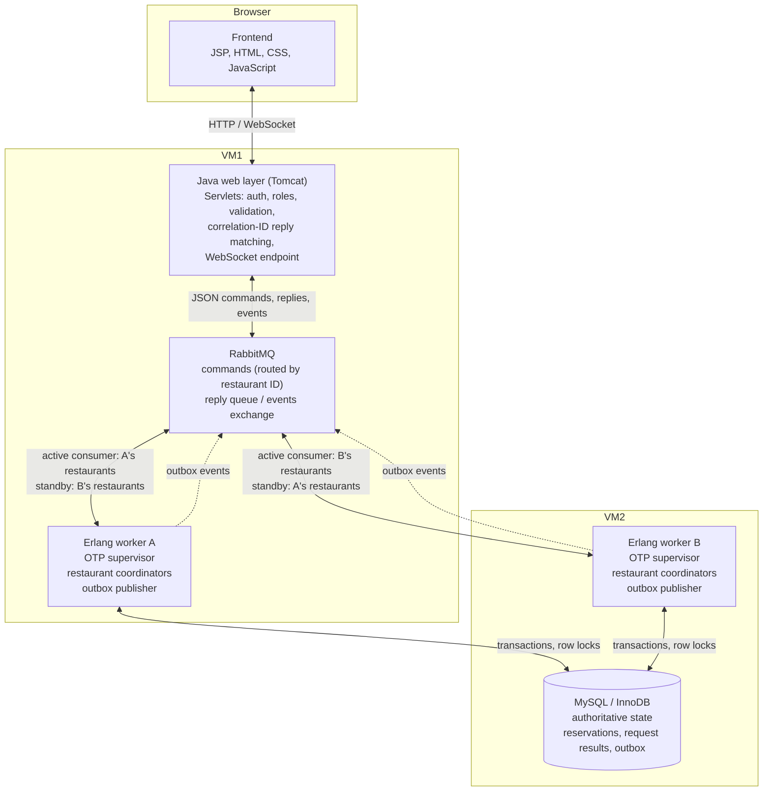
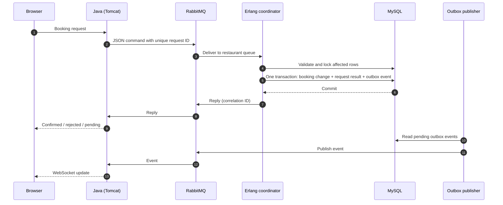

# GatherSeat

**A distributed restaurant reservation system with group confirmations and waiting lists.**

Course project for *Distributed Systems and Middleware Technologies* (University of Pisa, MSc, a.y. 2026/27).


GatherSeat supports ordinary bookings, group bookings that need confirmation from every member before a deadline, and waiting lists. It guarantees that no table is ever double-booked and that the system recovers safely when a worker crashes.

---

## Table of contents

1. [Goals and scope](#goals-and-scope)
2. [Architecture](#architecture)
3. [Technologies](#technologies)
4. [Components](#components)
5. [Booking flow](#booking-flow)
6. [Reliability and consistency rules](#reliability-and-consistency-rules)
7. [Deployment](#deployment)
8. [Required demonstrations](#required-demonstrations)
9. [Repository structure](#repository-structure)
10. [Getting started](#getting-started)
11. [Team](#team)
12. [Timeline](#timeline)

---

## Goals and scope

**Goal:** build a distributed reservation system that supports ordinary bookings, group confirmations and waiting lists, prevents double bookings, and recovers safely from worker crashes.

**In scope**

- Fixed, non-overlapping dining slots
- One table per reservation (smallest available table that fits the party)
- Fixed group membership during a group hold
- Worker-crash recovery while RabbitMQ and MySQL stay available

**Out of scope**

- Payments
- Joined tables
- Multi-restaurant booking packages
- Full VM or database failover (MySQL and RabbitMQ are shared dependencies)

---

## Architecture



Active restaurants are distributed across both workers. Each restaurant has its own queue with a single active consumer, and a standby consumer on the other worker takes over if the active one dies.

---

## Technologies

**Frontend**


**Backend**


**Middleware and data**


**Deployment**


| Layer | Technology | Why |
|---|---|---|
| Frontend | JSP, HTML, CSS, JavaScript | Server-rendered pages with live updates over WebSocket |
| Web layer | Java Servlets on Apache Tomcat | Authentication, request validation, request/reply correlation |
| Messaging | RabbitMQ | Routing by restaurant ID, request/reply, pub/sub notifications, acknowledgements and redelivery |
| Reservation service | Erlang/OTP | Supervised, isolated restaurant coordinators; fast restart after failure |
| Database | MySQL (InnoDB) | Transactions, constraints and row locking as the source of truth |
| Deployment | Docker, multi-VM setup | Two VMs, two Erlang workers |

---

## Components

### Frontend (JSP, HTML, CSS, JavaScript)

- Registration, login and restaurant search with availability
- Booking, cancellation and "My bookings"
- Group invitations, member responses and deadline countdown
- Waiting-list offers and in-app notifications
- Manager pages for restaurants, tables, dining slots and reservations
- Status dashboard
- WebSocket updates for changing availability and booking status

### Java web layer (Servlets on Tomcat)

- Authenticates users and checks customer/manager permissions
- Validates requests and sends JSON commands through RabbitMQ
- Matches replies using correlation IDs
- Shows confirmed, rejected or pending/unknown outcomes correctly
- Forwards notification events to browsers

### Messaging (RabbitMQ)

- Routes booking commands by restaurant ID
- One active consumer per restaurant queue, with a standby on the other Erlang worker
- Carries request/reply messages and publishes notification events
- Commands are acknowledged after processing; redelivery is handled safely

### Reservation service (Erlang/OTP)

- Supervised restaurant coordinators across two workers
- Selects the smallest available table that fits the party
- Manages bookings, cancellations, group responses and hold expiry
- Gives released tables to the earliest compatible waiting-list entry
- Recovers persisted pending work after restart

### Database (MySQL/InnoDB)

- Stores users, restaurants, tables, slots, reservations, group members, offers and deadlines
- Uses transactions, constraints and a consistent locking order
- Prevents duplicate table/slot allocations and simultaneous bookings for the same member across restaurants
- Stores processed request results and pending outbox events
- MySQL is authoritative; Erlang memory must always be recoverable from it

---

## Booking flow



1. Browser sends a request to Java.
2. Java sends a command with a unique request ID through RabbitMQ.
3. Erlang validates and locks the affected database records.
4. One transaction saves the booking change, the request result and the outbox event.
5. After commit, the result returns to the customer.
6. An outbox publisher delivers the event; Java updates browsers.

---

## Reliability and consistency rules

- **Idempotency:** repeating a request returns its stored result without repeating the booking.
- **Unknown outcomes:** a timeout means the outcome is unknown; retry or check using the same request ID.
- **Persistent deadlines:** group and waiting-list deadlines are stored, and expired holds are scanned for after restarts.
- **Event integrity:** events are deduplicated, and versions reject stale updates.
- **Database unavailable:** no new bookings are confirmed when MySQL is unreachable.
- **Cross-restaurant guarantee:** one member cannot hold overlapping active bookings across restaurants. This is enforced in MySQL through constraints and a fixed lock order, not in Erlang memory.
- **Authoritative state:** MySQL is the source of truth, and Erlang state is rebuilt from it after a crash.

---

## Deployment

| Machine | Services |
|---|---|
| **VM1** | Tomcat (Java web layer), RabbitMQ, Erlang worker A |
| **VM2** | MySQL, Erlang worker B |

- Active restaurants are distributed across both workers.
- Failure scope is **worker recovery** while RabbitMQ and MySQL remain available. Full VM or database failover is outside this project's scope.

---

## Required demonstrations

| # | Scenario | Expected result |
|---|---|---|
| 1 | 100 requests competing for one table | Exactly one allocation |
| 2 | Concurrent group confirmations | One final reservation |
| 3 | Group confirmation racing with expiry | One valid outcome |
| 4 | One member in competing groups | One active booking |
| 5 | Waiting-list promotion | Released table goes to the earliest compatible entry |
| 6 | Worker crash after commit | Safe retry, no duplicate effect |
| 7 | Outbox publisher restart | Eventual event delivery without duplicate effects |

---

## Repository structure

> Proposed layout. Adjust to match the actual code.

```
gatherseat/
├── web/                 # Java web layer (Servlets, JSP, static assets)
│   └── src/
├── erlang/              # Erlang/OTP reservation service
│   ├── apps/
│   └── config/
├── db/                  # MySQL schema, migrations, seed data
├── messaging/           # RabbitMQ definitions (exchanges, queues, bindings)
├── deploy/              # Docker and multi-VM deployment files
├── tests/               # Concurrency, crash-recovery and outbox tests
├── docs/                # Report, architecture and state diagrams, demo script
└── README.md
```

---

## Getting started

> Fill in the exact versions and commands once the stack is fixed.

### Prerequisites

- JDK and Maven
- Apache Tomcat
- Erlang/OTP and rebar3
- RabbitMQ
- MySQL
- Docker and Docker Compose

### Run locally

```bash
# 1. Start infrastructure (MySQL, RabbitMQ)
docker compose up -d

# 2. Initialise the database
mysql -u <user> -p < db/schema.sql

# 3. Start the Erlang worker(s)
cd erlang && rebar3 shell

# 4. Build and deploy the Java web layer
cd web && mvn clean package
# copy the WAR to Tomcat's webapps/ directory
```

### Run the demonstrations

```bash
# Scripts live in tests/ (see docs/ for the demo script)
```

---

## Team

| Member | GitHub | Area | Responsibilities |
|---|---|---|---|
| **Muhammad Abuzar Thanvi** | [@abuzarthanvi25](https://github.com/abuzarthanvi25) | Java + Interface | Servlets/JSP, login and roles, restaurant search, booking/cancellation screens, group responses, waiting-list screens, status dashboard |
| **Muhammad Haroon Shahzad** | [@HaroonMalik771](https://github.com/HaroonMalik771) | Erlang/OTP | Supervised restaurant coordinators, table allocation, group holds, confirmations and expiry, waiting-list offers, worker restart and deadline recovery |
| **Ouballouk Mohamed** | [@username](https://github.com/username) | Persistence + Messaging | MySQL schema and transaction helpers, RabbitMQ request/reply, request deduplication, outbox publishing, Docker and multi-VM deployment |

All three members review transaction correctness, concurrency tests, integration and the final report.

---

## Course

*Distributed Systems and Middleware Technologies*, MSc, University of Pisa.
